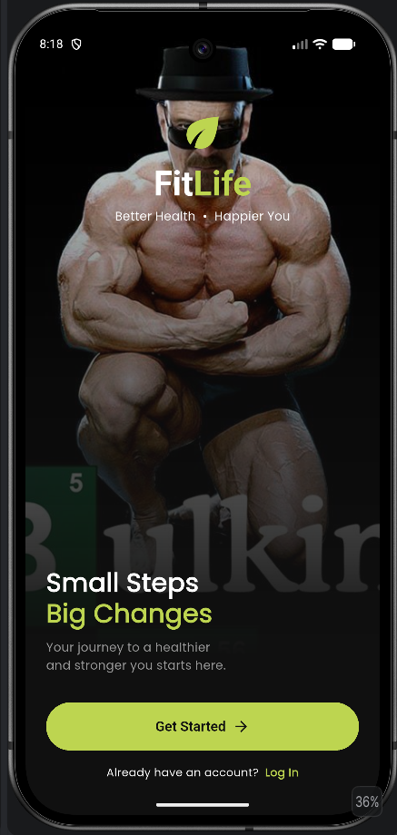
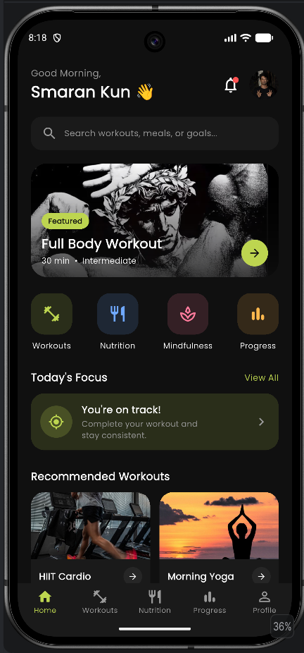
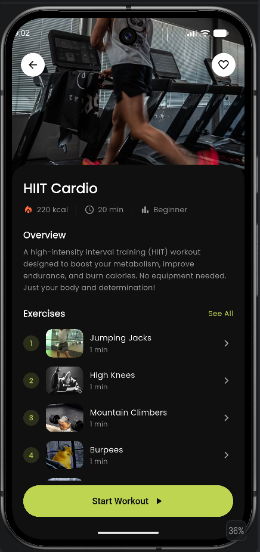

# FitLife

A fitness app UI built with **Flutter**, based on a 3-screen design prototype: Splash, Home Dashboard and Workout Details. It uses a custom dark theme with a lime accent.

> **Better Health • Happier You**

## Screenshots

| Splash | Home | Workout Details                     |
|---|---|-------------------------------------|
|  |  |  |

*(Add your own screenshots to a `screenshots/` folder and the table above will display them.)*

## Features

- **Splash screen** with a full-bleed photo, gradient overlay, logo and a "Get Started" button with a fade transition
- **Bottom navigation** with five tabs: Home, Workouts, Nutrition, Progress, Profile
- **Home dashboard**
    - Greeting header with notification bell and avatar
    - Search bar
    - Featured workout card
    - Category shortcuts (Workouts, Nutrition, Mindfulness, Progress)
    - "Today's Focus" card
    - Recommended workouts
- **Workout details**
    - Header image with back and favorite buttons (the heart toggles)
    - Stats row (calories, duration, level)
    - Overview and numbered exercise list
    - "What You Need" card
    - Fixed "Start Workout" button
- Dark theme with a custom color palette
- Missing images fall back to dark placeholders instead of crashing

## Theme

| Role | Color |
|---|---|
| Background | `#101010` |
| Primary (accent) | `#BDD550` |

Supporting colors (surfaces, greys) are defined in `lib/core/app_colors.dart`.

## Tech Stack

- [Flutter](https://flutter.dev) (Dart)
- [google_fonts](https://pub.dev/packages/google_fonts) `8.2.1` (Poppins)
- Static dummy data (no backend)

## Project Structure

```
lib/
├── main.dart
├── core/
│   ├── app_colors.dart
│   └── app_theme.dart
├── models/
│   ├── workout.dart
│   └── exercise.dart
├── data/
│   └── dummy_data.dart
├── screens/
│   ├── main_shell.dart          # bottom navigation
│   ├── splash/
│   │   └── splash_screen.dart
│   ├── home/
│   │   ├── home_screen.dart
│   │   └── widgets/
│   │       ├── feature_card.dart
│   │       ├── category_row.dart
│   │       ├── todays_focus.dart
│   │       └── workout_card.dart
│   └── work_detail/
│       ├── workout_detail_screen.dart
│       └── widgets/
│           ├── exercise_tile.dart
│           └── stat_chip.dart
└── widgets/
    ├── primary_button.dart
    └── placeholder_screen.dart
```

## Getting Started

### Prerequisites

- Flutter SDK installed ([installation guide](https://docs.flutter.dev/get-started/install))
- An emulator or a physical device with USB debugging enabled

### Run the app

```bash
# 1. Clone the repository
git clone https://github.com/<your-username>/fitlife.git
cd fitlife

# 2. Install dependencies
flutter pub get

# 3. Run
flutter run
```

### Required image assets

Place these files in `assets/images/` (filenames must match exactly):

```
splash_bg.jpg
featured.jpg
hiit.jpg
yoga.jpg
avatar.jpg
ex_jumping_jacks.jpg
ex_high_knees.jpg
ex_mountain_climbers.jpg
ex_burpees.jpg
```

`splash_bg.jpg` is required for the splash screen to load. The other images show a placeholder if missing.

### Build an APK

```bash
flutter build apk --release
```

The APK is generated at `build/app/outputs/flutter-apk/app-release.apk`.

## Known Notes

- `google_fonts` is pinned to `8.2.1` because newer versions return a `TextTheme` type that doesn't match Flutter's `ThemeData` in this setup. If you migrate the project to `material_ui`, you can upgrade it.
- Workouts, Nutrition, Progress and Profile tabs are placeholders for now.
- The search bar and the Start Workout button are UI only.

## Roadmap

- [ ] Workouts tab listing all workouts
- [ ] Workout timer / player screen
- [ ] Working search
- [ ] Login and sign-up screens
- [ ] Persistent favorites (`shared_preferences`)
- [ ] Nutrition, Progress and Profile screens

## Author

**Your Name**
GitHub: [@your-username](https://github.com/your-username)

## License

This project is for learning purposes. Add a license of your choice (for example MIT) before sharing it publicly.
